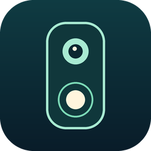

# Valore Ringbell

Integrace zvonku **Valore IP07 / X6** pro Home Assistant. Běží v Home Assistantu
a vytvoří jedno zařízení s kamerou a samostatnou událostí **Zazvonění**.
Obraz se spouští při otevření kamery. Fyzický stisk zvonku lze použít
pro automatizace i pro upozornění v Apple Domácnosti.

## Instalace

[](https://my.home-assistant.io/redirect/marketplace_repository/?owner=paveto&repository=valore-ringbell-ha&category=integration)

1. V **Nastavení → Tržiště → ⋮ → Vlastní repozitáře** přidej
   `https://github.com/paveto/valore-ringbell-ha`.
   Pokud používáš HACS, otevři **HACS → ⋮ → Vlastní repozitáře** a vyber typ **Integrace**.
2. Nainstaluj **Valore Ringbell**. Pokud to Home Assistant vyžádá, restartuj ho.
3. V **Nastavení → Zařízení a služby → Přidat integraci** vyhledej **Valore Ringbell**.
4. Zadej údaje účtu Tuya Smart a předvolbu země (pro český účet `420`).
   Vyber zvonek podle jména a potvrď. Při shodě názvů pomáhá koncovka ID.

Home Assistant ukládá údaje do vlastní konfigurace. Přístup k ní má mít
jen správce. Tuya Smart je potřeba k prvotnímu spárování zařízení a ke správě
účtu. Tato verze byla ověřena na Home Assistantu 2026.10.4 a 2026.11.3 se simulovaným zvonkem.

## Karta na nástěnce

V seznamu entit má kamera stejný název jako zařízení a ikonu videokamery.
Otevřením této entity můžeš ověřit obraz přímo v Home Assistantu.

### Webový zvonek

Po instalaci verze 0.1.4 a restartu Home Assistantu načti webovou stránku znovu.
Na nástěnce zvol **Upravit nástěnku → Přidat kartu → Ručně**. Vlož konfiguraci
a nahraď obě ID skutečnými ID svých entit.

```yaml
type: custom:valore-doorbell-card
name: U dveří
camera: camera.inteligentni_zvonek
event_entity: event.inteligentni_zvonek_zazvoneni
```

Na kartě klikni na **Zapnout zvuk**. Krátké dvojité zazvonění ověří hlasitost.
Dokud je karta otevřená na nástěnce, nový stisk ji rozezní a otevře živý obraz
nejvýše na 45 sekund. **Otevřít obraz** a **Zavřít obraz** fungují i ručně.
Prohlížeč může vyžadovat nové povolení zvuku po zavření nebo obnovení stránky.

## Oznámení v Home Assistantu

### iPhone

1. [Importuj šablonu Valore Ringbell](https://my.home-assistant.io/redirect/blueprint_import/?blueprint_url=https%3A%2F%2Fgithub.com%2Fpaveto%2Fvalore-ringbell-ha%2Fblob%2Fmain%2Fblueprints%2Fautomation%2Fvalore_ringbell_iphone.yaml)
   a vytvoř z ní automatizaci.
2. Vyber **Zazvonění**, kameru **Inteligentní zvonek** a svůj **iPhone**
   registrovaný v aplikaci Home Assistant. Ulož automatizaci.
3. Po stisku iPhone přehraje zvuk oznámení. Klepnutím otevřeš kameru.
   Podržením oznámení můžeš zobrazit náhled včetně živého MJPEG, pokud je zvonek dostupný.

Zvuk je ve výchozím nastavení stejný jako běžné oznámení Home Assistantu.
Pokud máš vlastní zvuk, můžeš ho [importovat do Companion App](https://companion.home-assistant.io/docs/notifications/notification-sounds/#custom-push-notification-sounds)
a do automatizace zadat název souboru. Pokud už máš pro tentýž zvonek
jinou automatizaci s oznámením, vypni ji, aby iPhone nezazvonil dvakrát.

Integrace kontroluje centrum zpráv Tuya každých 15 sekund při běžném provozu.
Při opakovaném výpadku nebo omezení požadavků interval prodlouží.
Atribut `detection_delay_seconds` na entitě zazvonění ukazuje rozdíl mezi
časem zprávy od Tuya a jejím zachycením v Home Assistantu.

## Apple Domácnost

Přidej vlastní instanci [HomeKit Bridge](https://www.home-assistant.io/integrations/homekit/)
pro kameru v režimu `accessory`. Pro propojení zazvonění s kamerou použij
v `configuration.yaml` nastavení `linked_doorbell_sensor`. Názvy entit nahraď
skutečnými z detailu zařízení v Home Assistantu.

```yaml
homekit:
  - name: Valore u dveří
    mode: accessory
    port: 21065
    filter:
      include_entities:
        - camera.valore
    entity_config:
      camera.valore:
        linked_doorbell_sensor: event.valore_zazvoneni
        max_width: 640
        max_height: 480
        max_fps: 15
```

Pokud už v souboru máš položku `homekit:`, přidej příklad jako další položku
pod ni. Po restartu spáruj nové příslušenství pomocí kódu HomeKit Bridge
a vyzkoušej živý náhled i fyzické zazvonění. FFmpeg dostává obraz ze smyčky
`127.0.0.1`, takže stačí síťové připojení potřebné k párování samotného HomeKitu.

Verze 0.1 nabízí živý obraz a událost tlačítka. U spícího bateriového zvonku
může náběh obrazu trvat déle než čeká Apple Domácnost. Při otevření náhledu
integrace požádá o probuzení, pokud zařízení přes Tuya hlásí spánek nebo
napájení z baterie bez údaje `wireless_awake`. Při potížích porovnej
chování po fyzickém zazvonění a po delší době nečinnosti. Obousměrný zvuk
z původního panelu do této verze ještě přenesený není.
